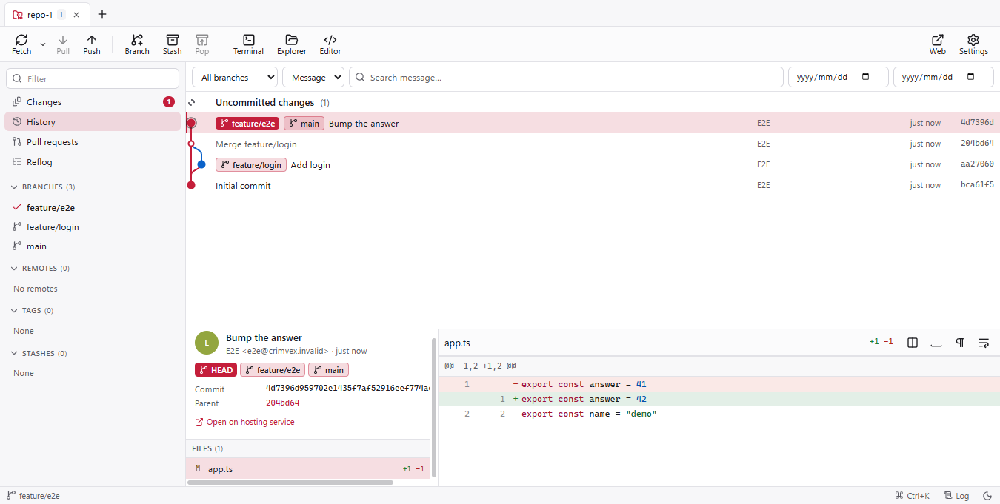
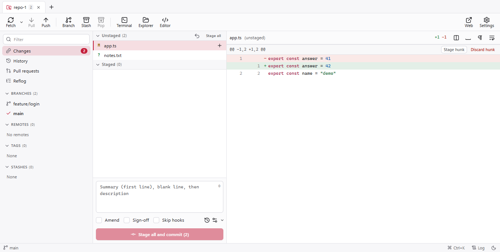
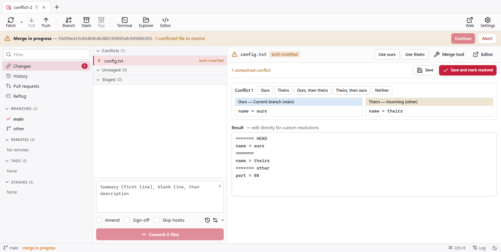
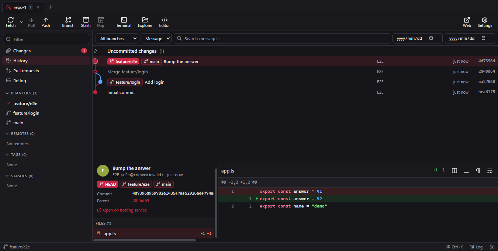

# Spoon

Spoon is a fast, local-first, open-source desktop Git client. It drives the Git you already have
installed, keeps your work on your machine, and asks before it does anything you can't easily undo.

> **Status: 0.1, pre-release.** Built and tested on Windows 11. macOS and Linux builds are configured
> but have not been tested yet.



## Features

- **Repository tabs** with a recent-repositories list, open/clone/init, repository trust prompts for
  Git's `safe.directory` (never added silently).
- **History** with a virtualised commit graph, branch filter, message/author/path/content search,
  date range, commit details and diffs.
- **Changes**: stage/unstage files, hunks or individual lines; unified and side-by-side diffs with
  syntax highlighting; image diffs; commit, amend, sign-off, commit templates.
- **Branches, remotes, tags, stashes** in the sidebar with context menus; fetch/pull/push with
  progress and cancel; force push only via an explicit `--force-with-lease` confirmation.
- **Merge, rebase, interactive rebase** (reorder/squash/fixup/reword/drop), cherry-pick, revert,
  reset with clear warnings.
- **Conflict workspace** with ours/theirs/both choices per conflict and continue/abort/skip.
- **Worktrees, submodules, bisect, git-flow, reflog recovery, blame, file history, tree browser,
  .gitignore editor, repository settings.**
- **Hosting integrations** for GitHub, GitLab, Bitbucket Cloud and Azure DevOps using personal access
  tokens stored with OS encryption (Experimental — not yet verified against live services).
- **Command palette** (Ctrl/Cmd+K), configurable shortcuts, light/dark/system themes, operation log.
- No telemetry, no account required, no cloud services needed for local work.

The full, honest status of every feature is in the [feature matrix](docs/product/feature-matrix.md).

| Changes                                  | Conflict resolution                        | Dark theme                                 |
| ---------------------------------------- | ------------------------------------------ | ------------------------------------------ |
|  |  |  |

## Requirements

- Git 2.25 or newer ([git-scm.com](https://git-scm.com/downloads)). Git LFS is optional.
- To build: Node.js 20.19+ and npm.

## Getting started

```bash
git clone https://github.com/Barkerbg001/spoon.git
cd spoon
npm install
npm run dev          # run with hot reload
npm run build && npm start
```

## Packaging

```bash
npm run package:win     # NSIS installer + zip (x64, arm64)
npm run package:mac     # dmg + zip (needs macOS)
npm run package:linux   # AppImage, deb, tar.gz
```

Output goes to `dist/`. Nothing is published or uploaded automatically. Builds are unsigned unless
you configure signing — see [docs/packaging.md](docs/packaging.md).

## Testing

```bash
npm run check       # typecheck, lint, format check, unit + integration tests
npm run test:e2e    # Playwright end-to-end tests against the built app
npm run perf        # large-repository benchmark
```

All tests create throwaway repositories in the temp folder and isolate Git configuration.

## Documentation

- [Architecture](docs/architecture.md) and [security model](SECURITY.md)
- [Development guide](docs/development.md)
- [Feature matrix](docs/product/feature-matrix.md), [roadmap](docs/roadmap.md), [progress](docs/progress.md)
- [Performance](docs/performance.md), [packaging](docs/packaging.md), [licensing](docs/licensing.md)

## Contributing

Contributions are welcome — please read [CONTRIBUTING.md](CONTRIBUTING.md) and the
[Code of Conduct](CODE_OF_CONDUCT.md). Report security issues privately as described in
[SECURITY.md](SECURITY.md).

## Acknowledgements

Spoon is built on Git, Electron, React and many other open-source projects. Their licences are
listed in [THIRD_PARTY_NOTICES.md](THIRD_PARTY_NOTICES.md).
