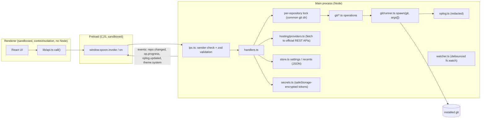

# Spoon architecture

Spoon is an Electron application with three isolated layers. The renderer never touches the
file system, child processes or the network directly; every privileged action goes through one
validated IPC entry point in the main process, which runs the installed Git CLI.

## Source layout

| Path                                                              | Responsibility                                                                                                                                                                                                                                                  |
| ----------------------------------------------------------------- | --------------------------------------------------------------------------------------------------------------------------------------------------------------------------------------------------------------------------------------------------------------- |
| `src/shared/api.ts`                                               | The complete IPC contract: one zod schema and result type per method, plus event payload types. Both processes import it, so the renderer is type-checked against the main process.                                                                             |
| `src/shared/types.ts`                                             | Plain data types exchanged over IPC.                                                                                                                                                                                                                            |
| `src/shared/diff.ts`, `conflict.ts`, `graph.ts`, `remoteUrl.ts`   | Pure, unit-tested logic: unified-diff parsing and partial-patch building, conflict-marker parsing and resolution, commit-graph lane layout, remote URL parsing.                                                                                                 |
| `src/main/index.ts`                                               | Window creation, security settings (sandbox, CSP, navigation and window-open guards, permission denial).                                                                                                                                                        |
| `src/main/ipc.ts`                                                 | Registers the single `spoon:invoke` channel. Rejects calls whose sending frame is not the app's own renderer URL, validates arguments with the method's schema, serialises mutating calls per repository, and converts errors into `{ code, message, detail }`. |
| `src/main/handlers.ts`                                            | Thin mapping from API methods to operations; also the `Services` container (settings, recents, secrets, watchers, auto-fetch).                                                                                                                                  |
| `src/main/git/runner.ts`                                          | Git discovery and capability detection; the only place that spawns Git.                                                                                                                                                                                         |
| `src/main/git/repo.ts`                                            | Repository resolution (`rev-parse`), operation-state detection, status and summary.                                                                                                                                                                             |
| `src/main/git/{history,changes,branches,conflicts,ops,extras}.ts` | Git features grouped by area.                                                                                                                                                                                                                                   |
| `src/main/git/parse.ts`                                           | Parsers for NUL-delimited porcelain output (status v2, log, refs, blame, ls-tree, reflog, worktrees).                                                                                                                                                           |
| `src/main/hosting/providers.ts`                                   | `HostingProvider` interface with GitHub, GitLab, Bitbucket Cloud and Azure DevOps implementations.                                                                                                                                                              |
| `src/main/launch.ts`                                              | Starting external editors/terminals/tools with argument arrays; external URL validation.                                                                                                                                                                        |
| `src/main/redact.ts`, `oplog.ts`                                  | Credential redaction and the visible operation log.                                                                                                                                                                                                             |
| `src/preload/index.ts`                                            | Exposes only `invoke(method, args)`, `on(event, listener)` and `platform`.                                                                                                                                                                                      |
| `src/renderer/src/app`                                            | Application shell: state store, tabs, command palette, settings, dialogs, shortcuts, repository workspace (toolbar, sidebar, banners).                                                                                                                          |
| `src/renderer/src/views`                                          | Feature views: history (graph, details, interactive rebase), changes (file list, commit box), diff, conflict workspace, explore (file history, blame, tree, reflog, compare), pull requests, repository settings.                                               |

## Running Git safely

- Git is always started with `spawn(gitPath, args, { shell: false })`. There is no code path that
  concatenates a command line (ESLint forbids `exec`/`execSync` in the main process). On Windows,
  `.cmd`/`.bat` launchers for _external tools_ are refused when an argument contains characters
  `cmd.exe` would interpret.
- Values that become Git arguments are validated by zod before any handler runs: refs and
  revisions may not start with `-`, paths must be relative and stay inside the repository, NUL bytes
  are rejected, and the `ext::` transport is refused. Where Git supports it, `--end-of-options` or
  `--` separates options from user values (Git 2.33's `reset` and `bisect` do not accept
  `--end-of-options`; for those the validation is the guard).
- Every invocation sets `GIT_TERMINAL_PROMPT=0` (no hidden credential prompts), `LC_ALL=C`
  (stable parseable messages), `GIT_LITERAL_PATHSPECS=1` (file names such as `a[1].txt` are
  literal), `GIT_EDITOR=:` (no editor ever opens), `core.quotepath=false` and `color.ui=false`.
  Read-only commands also set `GIT_OPTIONAL_LOCKS=0`, so background status refreshes never
  contend with the user's own Git usage.
- Output is parsed from NUL-delimited formats (`status --porcelain=v2 -z`, `log -z`,
  `for-each-ref` with `%00`). Unicode file names and names with spaces or newlines are covered by
  integration tests.
- Long-running operations (clone, fetch, pull, push, submodule update, merge tools) carry an
  operation id; progress lines are parsed into `op.progress` events and `op.cancel` kills the
  whole process tree. A cancelled clone removes the partially created folder.
- Mutating calls are serialised per repository. The lock key is the _common_ git directory, so
  linked worktrees of the same repository never run conflicting commands at the same time.
- Git's stderr is translated into actionable error codes (`AUTH`, `NETWORK`, `CONFLICT`,
  `UNSAFE_REPOSITORY`, …) while the original text stays available as `detail`.

### Never silently

The following only happen after an explicit, specific confirmation in the UI: changing global Git
configuration (identity, `safe.directory`), discarding changes, stashing (e.g. "stash and check
out"), force pushing (only `--force-with-lease`, with a list of remote commits that would be lost),
hard reset (lists files that lose changes), deleting unmerged branches. Certificate verification is
never disabled.

## Renderer security

- `contextIsolation: true`, `sandbox: true`, `nodeIntegration: false`, `webviewTag: false`;
  `app.enableSandbox()` applies to every renderer.
- Content Security Policy: `default-src 'self'; script-src 'self'; object-src 'none'; frame-src
'none'; base-uri 'none'; form-action 'none'` (inline styles are allowed for layout only).
- `will-navigate` is cancelled for anything except the app's own page; `window.open` is denied and
  only `http(s)` URLs without embedded credentials are passed to the OS browser.
- All permission requests (camera, notifications from web content, etc.) are denied.
- Repository content is treated as data: diffs and file contents are HTML-escaped before syntax
  highlighting, pull-request descriptions are shown as plain text (no Markdown/HTML rendering),
  SVG files are never rendered as images, and images are displayed from `data:` URLs produced by
  the main process.
- The IPC handler checks that the calling frame's URL is the bundled renderer (or the dev server
  in development) before doing anything.

## Credentials

Spoon does not implement Git authentication itself. Remote operations use the user's configured
credential helper (e.g. Git Credential Manager) and SSH agent; because prompts are disabled, a
missing credential produces a clear `AUTH` error instead of a hidden prompt.

Hosting API tokens (personal access tokens) are encrypted with Electron `safeStorage`
(DPAPI on Windows, Keychain on macOS, libsecret/KWallet on Linux) and stored only as ciphertext.
If the OS cannot encrypt (or Linux falls back to the insecure `basic_text` backend), Spoon
refuses to store the token. Tokens never appear in settings files or logs, and the redactor removes
URL credentials, GitHub/GitLab token patterns, `Authorization` headers and `password=` lines from
everything recorded in the operation log.

## State and refresh

- Main process: `settings.json`, `recents.json` and `secrets.json` in the user-data folder
  (`SPOON_USER_DATA` overrides it for tests).
- Renderer: a small observable `Store` with selector hooks (`useStore`). Each open tab mounts a
  `RepoProvider` that loads status and refs, and coalesces refresh requests.
- `watcher.ts` watches the working tree and git directory (and the per-worktree and common git
  directories for linked worktrees), filters noisy paths (`objects/`, `logs/`, lock files), and
  emits a debounced `repo.changed` event with a scope (`worktree`, `refs`, `all`). The active tab
  also refreshes on window focus, and F5 forces a refresh.

## History graph

`layoutGraph(commits, previousState)` assigns lanes in topological order. Lanes are reused but
never compacted, and the layout state is carried from one page to the next, so rows that are
already on screen never move when more history loads. When a branch's first parent is already
waited for by a lane further right, that lane folds into the current column so the first-parent
line keeps the leftmost position. The list is virtualised; see [performance](performance.md).

## Partial staging

The diff view keys selectable lines as `hunkIndex:lineIndex`. The main process re-reads the diff,
compares a SHA-1 fingerprint of the raw diff with the one the renderer saw (rejecting stale
selections with `STALE`), builds a minimal patch (`buildPartialPatch`) and applies it with
`git apply --cached` (stage), `--cached --reverse` (unstage) or `--reverse` (discard).

## Hosting providers

`HostingProvider` covers detection from remote URLs (including self-hosted base URLs),
identity, pull/merge requests with checks, repository lists, notifications, the refspec used to
check out a pull request, and web URLs. Networking uses `fetch` against the services' documented
REST APIs, with explicit handling of 401/403/404 and rate limits. There is no OAuth flow: that
would require registered OAuth applications, and confidential client secrets must not be shipped in
a desktop app. GitHub and GitLab are marked "supported"; Bitbucket and Azure DevOps "experimental".
None of the providers has yet been verified against a live service (see the feature matrix).

## Testing strategy

| Layer       | Location            | What it covers                                                                                                                                               |
| ----------- | ------------------- | ------------------------------------------------------------------------------------------------------------------------------------------------------------ |
| Unit        | `tests/unit`        | Diff/partial patch, conflicts, graph, status/remote parsing, IPC schemas, redaction, URL trust, error classification, hosting providers with mocked `fetch`. |
| Integration | `tests/integration` | Real Git against disposable repositories and local bare remotes, isolated from the user's Git config via `GIT_CONFIG_GLOBAL`/`GIT_CONFIG_NOSYSTEM`.          |
| End to end  | `tests/e2e`         | Playwright drives the built Electron app with an isolated user-data folder and stubbed folder picker.                                                        |
| Performance | `tests/perf`        | Generates a 50 000-commit, 20 000-file repository and times the operations the UI depends on.                                                                |
